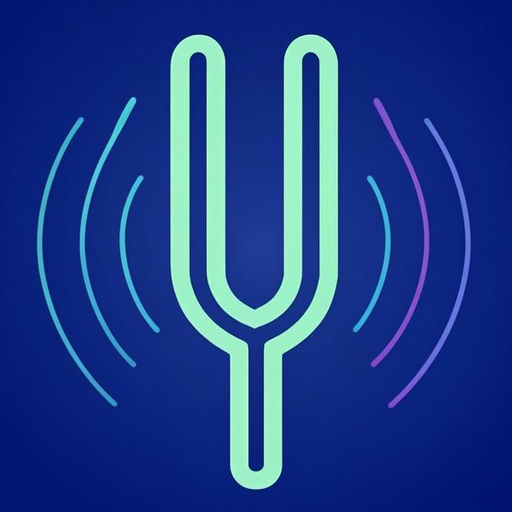

# 🎻 کوک‌یار — Kookyar

**دستیار دقیق و زیبای کوک برای سازهای ایرانی و جهانی**

**[⬇️ دانلود آخرین نسخه](https://github.com/Armin-ph/kookyar/releases/latest)** • [🐞 گزارش مشکل یا پیشنهاد](https://github.com/Armin-ph/kookyar/issues)

---

## 🌟 کوک‌یار چیست؟

**کوک‌یار** یک اپلیکیشن اندرویدی رایگان برای کوک کردن ساز است که مخصوص موسیقی **ایرانی** طراحی شده: تشخیص بلادرنگ زیرِ صدا با پشتیبانی کامل از **ربع‌پرده‌ها (سری و کرن)**، مترونوم حرفه‌ای، تمرین گوش و آمار تمرین — همه در یک اپ زیبا با سه تم خوش‌رنگ.

- 🎯 عقربهٔ دقیق با نوار ±۵۰ سنت و نمایش نت به نام‌گذاری ۲۴ درجه‌ای ایرانی (مثل «می کرن»، «لا سری»)
- 🔇 کارکرد مطمئن حتی در محیط‌های شلوغ و پرسروصدا
- 🎊 جلوه‌های بصری دلنشین: انفجار ذرات هنگام کوک شدن، موج‌های نئونی و صدای تأیید
- 📱 طراحی مدرن با فونت وزیرمتن، کاملاً راست‌به‌چپ

## ✨ امکانات

| بخش | توضیح |
|---|---|
| 🎯 **تیونر بلادرنگ** | تشخیص دقیق زیرِ صدا با الگوریتم YIN و نوار ±۵۰ سنت |
| 🎼 **ربع‌پرده (سری/کرن)** | نام‌گذاری ۲۴ درجه‌ای: دو سری، می کرن، لا کرن و… |
| 🪕 **سازها و کوک‌ها** | تار، سه‌تار، سنتور، کمانچه، گیتار، بیس، ویولن، یوکلیلی، پیانو + حالت کروماتیک و کوک‌های آمادهٔ هر ساز |
| 🔉 **صدای مرجع** | نواختن نت مرجع «لا» از ۴۳۰ تا ۴۵۰ هرتز (میان‌بُر ۴۳۲ / ۴۴۰ / ۴۴۲ / ۴۴۳) |
| ⏱ **مترونوم حرفه‌ای** | سرعت ۳۰ تا ۳۰۰ ضرب، تاپ‌تمپو، میزان‌های ۲/۴ تا ۱۲/۸ + میزان دلخواه، تقسیم‌بندی ضرب، الگوی تاکید، ۵ نوع صدا، تایمر تمرین و پیش‌تنظیم‌ها |
| 👂 **تمرین گوش** | بازی تشخیص نت با سطوح مختلف برای قوی‌تر شدن گوش موسیقایی |
| 📈 **تاریخچه و آمار** | نمودار دقت ۷ روزه، بهترین روز، دقت متوسط و روند تمرین |
| 🎨 **۳ تم زیبا** | تاریک شیشه‌ای، سنتی ایرانی، نئون |
| 🌐 **دو زبانه** | فارسی (پیش‌فرض) + English — تغییر زبان بدون ری‌استارت |
| 🔄 **به‌روزرسانی هوشمند** | بررسی نسخهٔ جدید از داخل اپ و دریافت از مارکت‌ها یا مستقیم |
| 📳 **بازخورد لمسی** | لرزش ظریف در لحظهٔ کوک شدن (قابل خاموش‌کردن) |

## 📲 نصب و راه‌اندازی

نیازمندی: **اندروید ۸ به بالا** — نصب کمتر از یک دقیقه.

| منبع | لینک |
|---|---|
| 🐙 گیت‌هاب (مستقیم — همیشه آخرین نسخه) | [github.com/Armin-ph/kookyar/releases/latest](https://github.com/Armin-ph/kookyar/releases/latest) |
| 🛍 کافه‌بازار | [cafebazaar.ir/app/com.kookyar.app](https://cafebazaar.ir/app/com.kookyar.app) |
| 🛍 مایکت | [myket.ir/app/com.kookyar.app](https://myket.ir/app/com.kookyar.app) |
| ▶️ Google Play | [play.google.com/store/apps/details?id=com.kookyar.app](https://play.google.com/store/apps/details?id=com.kookyar.app) |

**نصب از گیت‌هاب:**
1. از بخش **Releases** آخرین نسخه را دانلود کنید (فایل `kookyar-vX.X.X.apk`).
2. روی فایل دانلودشده بزنید.
3. اگر پرسیده شد، اجازهٔ «نصب از منابع ناشناس» را به مرورگر خود بدهید.
4. دکمهٔ نصب را بزنید — تمام! 🎉

> 💡 به‌روزرسانی‌های بعدی را خود اپ اعلام می‌کند: تنظیمات ▸ به‌روزرسانی برنامه

## 🔐 دسترسی‌های برنامه

کوک‌یار فقط حداقلِ دسترسی‌های لازم را می‌خواهد و برای هر کدام دلیل مشخص دارد:

| دسترسی | چرا لازم است؟ |
|---|---|
| 🎤 **میکروفن** | فقط برای شنیدن صدای سازتان هنگام کوک. هیچ صدایی **ذخیره یا ارسال نمی‌شود** — تحلیل صدا لحظه‌ای و کاملاً روی خود دستگاه انجام می‌شود. |
| 📳 **لرزش** | بازخورد لرزشی ظریف وقتی ساز کوک می‌شود. |
| 🌐 **اینترنت** | فقط برای «بررسی نسخهٔ جدید» در تنظیمات. تمام امکانات اصلی بدون اینترنت هم کامل کار می‌کنند. |
| 📦 **نصب بسته‌ها** | فقط وقتی بخواهید به‌روزرسانی را مستقیم از داخل اپ نصب کنید (مثل نصب APK از گیت‌هاب). |

## 🛡 حریم خصوصی

- 🔒 همهٔ پردازش‌های صوتی **۱۰۰٪ روی دستگاه** انجام می‌شود
- 🚫 هیچ صدایی ضبط، ذخیره یا به هیچ سروری ارسال نمی‌شود
- 🙈 بدون ثبت‌نام، بدون تبلیغات، بدون ردیابی — نه حساب کاربری می‌خواهد نه اطلاعات شخصی

## ❓ پرسش‌های پرتکرار

<b>آیا کوک‌یار بدون اینترنت کار می‌کند؟</b>

 

بله ✅ — تیونر، مترونوم، تمرین گوش و همهٔ امکانات اصلی کاملاً آفلاین‌اند. اینترنت فقط برای بررسی نسخهٔ جدید استفاده می‌شود.

<b>آیا صدای ساز من جایی ارسال می‌شود؟</b>

 

خیر ❌ — صدای میکروفن فقط لحظه‌ای داخل خود گوشی تحلیل می‌شود و هرگز ذخیره یا ارسال نمی‌شود. می‌توانید حتی حین کوک، اینترنت گوشی را قطع کنید و همه‌چیز مثل قبل کار می‌کند.

<b>سری و کرن چطور نمایش داده می‌شود؟</b>

 

کوک‌یار نت‌ها را با نام‌گذاری ۲۴ درجه‌ای موسیقی ایرانی نشان می‌دهد؛ یعنی به‌جای نیم‌پرده‌های غربی، «می کرن»، «دو سری» و… را می‌بینید. از تنظیمات می‌توانید نمایش ربع‌پرده‌ها را خاموش کنید.

<b>چطور به‌روزرسانی دریافت کنم؟</b>

 

تنظیمات ▸ «به‌روزرسانی برنامه» ▸ دکمهٔ بررسی. اگر نسخهٔ جدید باشد، می‌توانید از کافه‌بازار، مایکت، Google Play یا مستقیم (APK) نصب کنید. فهرست تغییرات هر نسخه هم همان‌جا در «نسخه و تغییرات» دیده می‌شود.

<b>عقربهٔ تیونر مرتب حرکت می‌کند و ثابت نمی‌ماند، مشکل چیست؟</b>

 

ساز را در محیط نسبتاً آرام کوک کنید و نزدیک به میکروفن بنوازید (تک‌تک سیم‌ها را جدا بکشید). اگر هنوز محیط شلوغ بود، کوک‌یار به‌طور خودکار نویز را نادیده می‌گیرد و فقط وقتی نت واضحی بشنود عقربه را حرکت می‌دهد.

## 💬 پشتیبانی

مشکلی دیدید یا ایده‌ای دارید؟ خوشحال می‌شویم بشنویم:

- 🐞 [گزارش باگ یا پیشنهاد در گیت‌هاب](https://github.com/Armin-ph/kookyar/issues)

---
**ساخته‌شده با ❤️ و 🎵 برای موسیقی ایرانی**

Kookyar © — همهٔ حقوق محفوظ است

